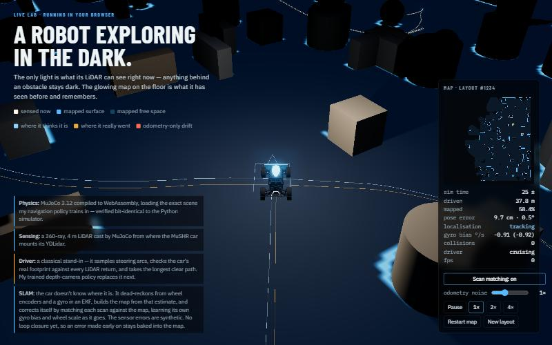

# Live Lab

A MuSHR race car exploring a dark arena in real MuJoCo physics, running entirely in the browser. The only light is what the car's LiDAR can see right now; anything behind an obstacle stays dark. The car doesn't know where it is: it estimates its own pose, builds a map from that estimate, and corrects itself against the map as it drives.

It is the interactive hero of my portfolio: the home page embeds it behind the text, and [`index.html`](index.html) here is the full lab with every control. Rather than describing navigation and SLAM, the page runs them.



## Run it

A static site with no build step.

```bash
python tools/serve.py 8765 ..
```

Then open <http://localhost:8765/lab/> (the trailing `..` serves the whole site, so the home page's hero works too). `?layout=<n>` reproduces a whole run — obstacle layout, sensor errors and respawns. [`parity.html`](parity.html) runs the physics check below.

`tools/serve.py` is a plain static server that sends `Cache-Control: no-store`. Python's built-in `http.server` sends no cache headers, so browsers reuse ES modules heuristically and an edited file can silently keep running its old version — which cost me one wrong conclusion before I found it.

## What is real, and what is a stand-in

| Part | Status |
|---|---|
| **Physics** | Real. MuJoCo 3.12 compiled to WebAssembly (`@mujoco/mujoco`, the official DeepMind bindings), loading the exact training scene from my navigation research. |
| **Scene** | Real. Exported from the training code by [`tools/export_scene.py`](tools/export_scene.py), not re-authored by hand. Obstacles are re-scattered per visit using the training rule. |
| **LiDAR** | Real raycasts by MuJoCo: 360 rays, 4 m range, from where the MuSHR car mounts its YDLidar. |
| **SLAM** | Real algorithms on real simulated sensors. The **sensor errors are synthetic**: the simulated encoders and gyro are perfect, so a per-session wheel scale error and gyro bias, plus per-sample noise, are injected. |
| **Driver** | **Stand-in.** A classical arc-sampling local planner. |

## How it works

**The darkness.** Each frame, the LiDAR polygon is drawn into a top-down mask with a radial falloff. Every world material samples that mask in its fragment shader, slightly toward the sensor, so the faces a ray actually struck are lit and their far sides are not. Obstacles cast the same occlusion shadows a range sensor has, with no shadow maps. The light is always the *true* sensor view.

**Odometry.** Rear-wheel encoders and the gyro are integrated at the 200 Hz physics rate. The wheel's effective rolling radius is **calibrated from the simulator**: least squares of true forward speed on encoder rate over 60 s of driving gives 0.05234 m (R² = 0.998), **7.2% above** the nominal 0.0488 m.

**The filter.** An EKF over **[x, y, θ, gyro bias, wheel scale error]**. The two calibration states matter: those errors are systematic, so their effect grows with time rather than its square root, and a white-noise model can't represent that (see below). Scan matches teach the filter its own sensor errors — it typically learns the gyro bias to within 0.03 °/s, and the page shows its estimate next to the true value.

**Scan matching.** A correlative matcher (after Olson, 2009) searches a window of poses and scores each by how well the scan's returns land on mapped surfaces in a blurred likelihood field. The window is the EKF's 3σ uncertainty, so the filter tells the matcher where to look. If the best pose lands on the window's edge, the window doubles and it searches again. Matches pass a χ² gate (3 dof, 99.9%).

**Mapping only while localised.** Scans are written into the map only while tracking. When matching is switched off, they go to a separate **drift layer** (coral): the map as odometry alone would have drawn it. When matching resumes and relocalises, the drift layer clears.

**Local map, keyframes and loop closure.** Tracking matches each scan against a *local* map of the last ~16 m of route, not the whole map, so drift genuinely builds up while the car explores. Every 0.4 m (or 15° of turning) the car drops a keyframe, its pose and that scan, into a pose graph linked to the previous keyframe by the front end's motion. When the graph puts the car within reach of a keyframe from far back along the route, a two-level correlative search (15 cm max-pooled cells, then the full field) matches the new scan against a small map built around the old keyframe, over up to ±2 m and ±20°. One match is never trusted: a second keyframe a little further on must imply the same rigid correction before either constraint enters the graph. Gauss-Newton then corrects the whole route at once. Its sparse normal equations are solved by conjugate gradients preconditioned with the odometry chain itself, which block elimination solves exactly, so only the loop closures need iterating. Both maps are rebuilt from the corrected keyframes, and the live estimate moves with its keyframe. Revisits that only confirm the map add their constraints without re-optimising.

**Wheel slip.** If a good match says the car moved under half of what the encoders claimed, that is slip: the filter treats the encoder distance as an upper bound, and freezes learning of its calibration so a spinning wheel is never learned as a wheel-scale error.

## Verified

**Physics parity with the training simulator.** `parity.html` replays a 3-second rollout recorded in Python and compares the car's pose at every control step: maximum position error **5.0×10⁻¹⁶ m**, orientation error **1.1×10⁻¹⁵** over 600 physics steps — identical to machine precision.

**Scan matcher, in isolation.** On a map built at the true pose, from offsets of up to 25 cm and 8° it recovers the true pose to within **0.9 cm and 0.5°**.

**SLAM before loop closure (previous version), over 10 layouts × 60 s at the default noise level** (600 simulated seconds, 19 respawns):

| | Result |
|---|---:|
| Mean position error vs ground truth | **11.0 cm** |
| Worst position error on any layout | 35.6 cm |
| Worst heading error | 3.4° |
| Time not tracking | 0 |
| Gyro bias learned to within (mean) | 0.03 °/s |
| Wheel scale learned to within (mean) | 0.47 percentage points |

The error is bounded rather than growing — it wanders in a band of a few to ~35 cm. Without loop closure, an error made early stays baked into the map; the car is consistent with its own slightly shifted map, which is why the page shows "tracking" while the estimate sits beside the car.

**Loop closure, over 10 layouts × 120 s per configuration** ([`bench.html`](bench.html); raw results in [`docs/bench-2026-10-30.json`](docs/bench-2026-10-30.json)):

| | Previous version: tracks against the whole map | Local map, no loop closure | Local map + loop closure |
|---|---:|---:|---:|
| Mean position error | 9.3 cm | 12.7 cm | **9.9 cm** |
| Median of the layouts' means | 8.3 cm | 11.8 cm | 9.5 cm |
| Worst position error | 33.8 cm | 45.0 cm | 41.9 cm |
| Map precision (wall cells within 5 cm of a real surface) | 78.0% | 65.7% | **80.1%** |
| Time lost (control steps) | 28 | 0 | **0** |
| Loop constraints, wrong against ground truth | — | — | **0 of 478** |

Loop closure cuts the local-map front end's mean error from 12.7 to 9.9 cm and lifts map precision from 65.7% to 80.1%. It closed 239 loops, and every one of its 478 constraints was right when checked against the simulator's ground truth. Against the previous version, mean error is about the same and the map is more accurate. The previous version matched every scan against the whole map, which in this small, constantly revisited arena is close to relocalising all the time. The new version is never lost. Its worst moments are worse (41.9 against 33.8 cm): drift builds while the car explores new ground, until a revisit lets a loop close.

**Recovery.** After learning, with matching switched off for 8 s at 2× and 3× noise (heading drift up to 10°), it returns to tracking within **0.5 s** of matching resuming.

**Wheel slip.** Parked against a wall at full throttle for 4 s, the encoders report **227 cm** of motion for a car that moved none. Before the slip handling, the estimate ran away to 169 cm and the filter declared itself lost; after it, the error stays under **15 cm** and the learned wheel scale is unchanged (1.57% before, 1.57% after; true 1.36%). On one layout, 58 of 60 slip flags were real slip (true travel under half the encoder distance, all while pushing an obstacle). The other 2 were false alarms at full speed with no contact, most likely a match sliding along a wall; their cost is that calibration learning pauses for half a second.

**Download.** About 1.7 MB, against 20 MB for the first version: the official WebAssembly build carries 5.8 MB of debug sections that never execute, so [`tools/strip_wasm.py`](tools/strip_wasm.py) removes them (10.1 MB → 4.4 MB, 1.2 MB compressed). The 200k-triangle chassis mesh is visual only, but MuJoCo derives the car's mass properties from its geoms, so [`tools/lighten_scene.py`](tools/lighten_scene.py) writes the compiled inertia into the model explicitly, simplifies the mesh to 13k triangles (10 MB → 129 KB gzipped), and checks that every body's mass properties are unchanged. The physics parity check above was re-run afterwards: still 5.0×10⁻¹⁶ m. Meshes ship gzipped because GitHub Pages doesn't compress STL; `src/sim.js` inflates them with `DecompressionStream`.

**Speed.** About 8–13× real time on a desktop with physics, LiDAR, SLAM and rendering together, depending on window size (rendering cost scales with pixels). Physics alone runs at about 55×.

**Stand-in planner**, over five layouts × 90 s: 546 m driven, 16 collisions — **34.1 m per collision**, against 2.7 m for the first follow-the-gap version, all of whose crashes were the front wheels clipping obstacles while turning. Not comparable to the trained policy, which sees only a forward depth camera.

## What went wrong on the way, and why it was fixed the way it was

Each of these was found by measuring, and each changed the design.

1. **Overconfident filter (68 cm error at σ = 0.7 cm).** With only white process noise, the filter believed its odometry was good to millimetres. Its gain toward scan matches collapsed to about 5%, and its 3σ search window shrank around a pose that had already drifted, so the true alignment was never even searched. Fix: estimate the gyro bias and wheel scale as states rather than inflating noise.
2. **False lock (185 cm while reporting "tracking").** Scans written into the map while dead-reckoning corrupted it, and later matches against the corrupted region confirmed the drift. Fix: write to the map only while tracking; the drift layer shows the rest.
3. **Wheel slip (multi-metre errors after respawns).** Respawns happen when the stand-in driver is stuck, and a stuck car spins its wheels. The encoders reported motion that wasn't happening; the window stayed too small to follow it, and the gate rejected the correct matches as implausible. My first hypothesis — getting lost in unmapped territory — was tested by teleporting the car into unmapped space, and it was wrong. Fix: the slip handling above.
4. **Slip leaking into calibration.** Freezing the calibration update wasn't enough: during slip the prediction step still correlated position with wheel scale, and the first normal update afterwards turned that into a 19–28% "scale error". Re-initialising also reset the calibration's uncertainty, making it trivial to overwrite. Fix: no position–scale coupling during slip, and re-initialisation keeps learned calibration *and* its confidence.
5. **Slow likelihood field (192 ms per simulated second).** It was rebuilt at every match with a closure call per blur tap. Fix: straight typed-array loops and a 4 Hz rebuild — the map barely changes in a quarter of a second, and a slightly older field avoids matching a scan against itself.
6. **A robust kernel that ignored the closures that mattered.** The first optimiser down-weighted loop edges with a Cauchy kernel scaled to their noise. A correct closure carries the whole accumulated drift (2.6 m in a test loop), so it got 0.04% of its weight and the optimiser crawled. Fix: no kernel; wrong closures are stopped before they reach the graph, by the two-match confirmation.
7. **Conjugate gradients needing one iteration per variable.** Preconditioned by the diagonal blocks alone, the solve took ~N iterations: about a second per Gauss-Newton step at 1,000 keyframes. Preconditioned by the odometry chain, solved exactly by block elimination, it takes 44 iterations for 1,041 keyframes and 72 loops: 129 ms from scratch, 20–30 ms per new closure.
8. **A match that put the car behind where it started.** In slip mode the filter's along-track uncertainty stays inflated, and a match 33 cm *behind* the last pose passed the gate while the wheels said 21 cm forward: a 63 cm glitch. Slip can make the car go less far than the wheels claim, never backwards, so such matches are now rejected.

## Things found in the tools

- **`mj_multiRay` misses relocated static geometry in MuJoCo 3.12.** After obstacles are moved through `model.geom_pos`, `mj_multiRay` passes straight through them, while `mj_ray` and the physics agree on where they are (one beam: 0.534 m from `mj_ray`, exactly centre distance minus radius; 3.499 m from `mj_multiRay`). The LiDAR uses one `mj_ray` per beam.
- **The simulated gyro equals the previous physics step's yaw rate** to within 9×10⁻¹⁵: a perfect sensor with a 5 ms lag, not an error.
- **The LiDAR sits at x = −0.0434 m** in the body frame, not the −0.035 m in the XML; MuJoCo recentres the mesh on its centroid. Measured from the model at startup.
- **The npm README lags the 3.12 bindings.** Buffers are `new DoubleBuffer(n)` or `DoubleBuffer.FromArray(arr)`, and the accessor is `GetView()`.
- **The exported car model's wheels sit tilted 26.6°.** dm_control compiles the scene with `angle="radian"`, so the wheel collision cylinders' `euler="90 0 0"` is read as 90 radians. The lab keeps the model exactly as exported, which is also why the calibrated rolling radius is 7.2% off nominal.

## Structure

```
index.html            the full lab: page, HUD and honesty notes
parity.html           browser-vs-Python physics check
bench.html            SLAM benchmark against ground truth (pose error, map precision, wrong loops)
src/lab.js            startLab(): loop, minimap, HUD, layouts; embeddable (the home page uses hero mode)
src/sim.js            loads the scene into MuJoCo WASM; stepping, car pose, collisions
src/lidar.js          360-ray LiDAR via mj_ray
src/slam.js           odometry, 5-state EKF, keyframes, local map, slip handling
src/matcher.js        correlative scan matcher, plus the two-level wide search for loop closure
src/graph.js          pose graph: Gauss-Newton with chain-preconditioned conjugate gradients
src/loop.js           loop-closure candidates, submaps and the two-match confirmation
src/mapping.js        log-odds occupancy grid
src/controller.js     stand-in arc-sampling local planner
src/render.js         three.js view: LiDAR-shaped light, map and drift layers, estimate and uncertainty
tools/export_scene.py exports the training scene and the parity reference
tools/lighten_scene.py explicit car inertia + simplified, gzipped meshes (physics unchanged)
tools/strip_wasm.py   removes debug sections from the MuJoCo WebAssembly build
tools/render_depth_view.py renders the policy's 64x128 depth view for the portfolio
tools/serve.py        no-cache static server for development
assets/scene/         exported scene.xml + meshes
vendor/mujoco/        @mujoco/mujoco 3.12.0 (matches the training MuJoCo), debug sections stripped
```

`window.__lab.advance(seconds)` steps the simulation and draws a frame without animation frames, which browsers suspend for hidden views; every number above was measured through it.

## Known limits

- The slip detector has occasional false alarms at speed along walls.
- Animation pauses while the tab is hidden, by design.

## Next

1. **Tighter worst case:** drift between loop closures. Candidates: closing loops against the global map sooner after a respawn, and a denser local map.
2. **The trained policy:** export the actor to ONNX, render the 64×128 depth image in the browser, verify it matches MuJoCo's depth render, and replace the stand-in.
3. ~~Loop closure~~, ~~load time~~ and ~~portfolio hero~~: done.
